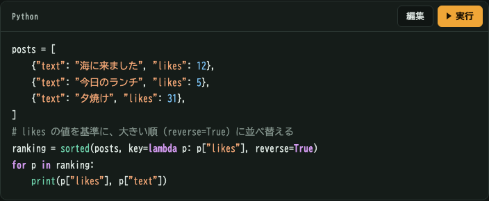
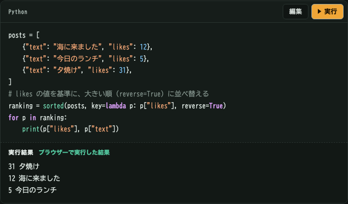
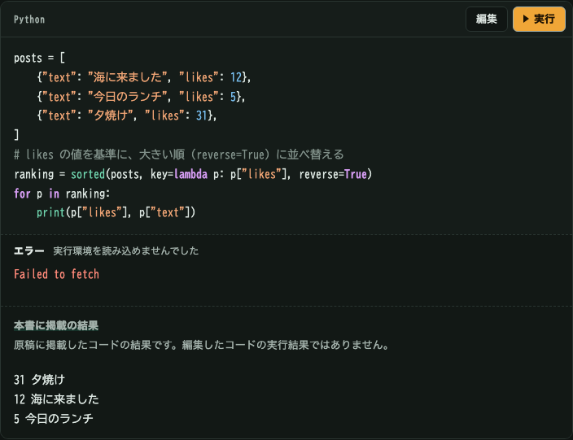
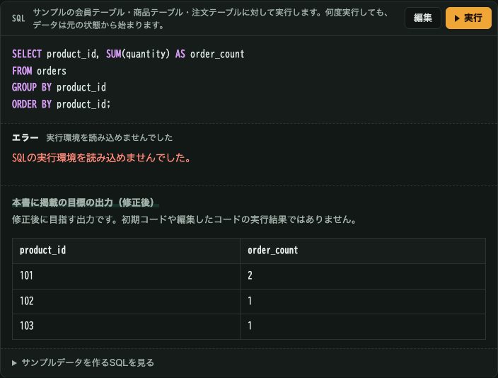

# コード例の表示確認

2026年11月5日に、ローカルで生成したWeb版をChromeで確認した画像です。画像はこのリポジトリ内に保存しているため、手元のMacへのアクセスは不要です。

## 実行前

ページを開いた時点では、結果欄は表示されません。

## 実行後

「実行」が完了すると、今回の実行結果が表示されます。編集・リセット・再実行の開始時には、この結果を消します。

## 実行環境を読み込めない場合

Pythonの実行環境の取得を意図的に失敗させた画面です。エラーとともに、原稿の掲載結果を参考表示します。編集したコードの結果と混同しないように、出典を明記します。

## 修正問題で読み込めない場合

SQLの実行環境の取得を意図的に失敗させた画面です。参考表示するのは修正後の目標であり、初期コードの結果ではありません。実行していないので、正誤の判定も表示しません。

コード自体のエラー、実行時間超過、手動中断では、掲載結果を参考表示しません。原稿に掲載結果がないコードでは、その旨を表示します。
